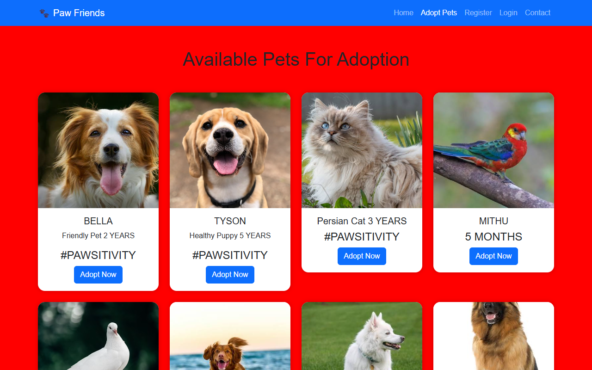

# Paw Friends: Pet Adoption Website

A responsive pet adoption website built with HTML5, CSS3 and Bootstrap 5. Visitors can browse pets available for adoption, register, log in and contact the shelter.

**Live demo:** https://vineetsing9019.github.io/pet-adoption-website/



## Pages

| Page | What it has |
|---|---|
| [Home](index.html) | Hero section ("Find Your Best Friend"), an Adopt Now button and a "Why Adopt?" section |
| [Adopt Pets](adoption.html) | Pet cards in a responsive grid: photo, name, age and an Adopt Now button |
| [Register](register.html) | Sign-up form |
| [Login](login.html) | Login form |
| [Contact](contact.html) | Contact form for the shelter |

## What I used

- **HTML5**: page structure, forms and inputs
- **CSS3**: custom styles in `style.css`
- **Bootstrap 5**: navbar that collapses on phones, grid (`col-lg-3 col-md-6`) for 4, 2 or 1 cards per row, cards and buttons
- Works on phone, tablet and laptop screens

## Run it

No install needed. Download or clone the repo and open `index.html` in a browser:

```bash
git clone https://github.com/Vineetsing9019/pet-adoption-website.git
```

## Author

Vineetsing Girase · [GitHub](https://github.com/Vineetsing9019)
